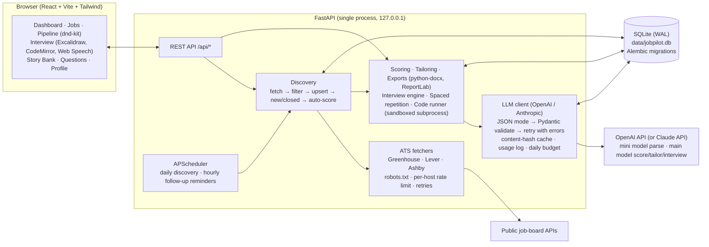

# JobPilot

A personal, local-first job-search and interview-prep system for **senior applied AI / AI engineer / forward-deployed engineer** roles.

JobPilot:

- **finds** openings on public ATS job boards (Greenhouse, Lever, Ashby) every day
- **scores** your fit with an LLM (OpenAI or Claude): 0–100, top 3 strengths, top 3 honest gaps, and a Strong / Stretch / Skip verdict
- **tailors** your materials per job: resume bullets, a .docx/.pdf resume, a cover letter, "why this company" notes, likely interview questions and outreach messages
- **tracks** your pipeline on a drag-and-drop kanban with follow-up reminders and a funnel dashboard
- **coaches** you with live mock interviews (system design with a whiteboard, ML fundamentals, behavioral from your story bank, coding with real test runs, and company-specific loops built from a JD), scorecards and spaced repetition

It is a single-user app. It runs on your machine and has no login. All personal data stays in a local SQLite file.

> **Human in the loop.** JobPilot never submits applications, never fills forms, never logs into job sites, and stores no job-site credentials. It prepares materials and opens the official apply page; you apply yourself.

---

## Quick start (Docker)

Only Docker is required (Docker Desktop, or Docker Engine with the compose plugin).

```bash
git clone <this repo> jobpilot && cd jobpilot
cp .env.example .env
```

Edit `.env`:

```ini
OPENAI_API_KEY=sk-...        # your OpenAI key
PORT=8000                    # change if 8000 is taken, e.g. PORT=8080
BIND_ADDRESS=127.0.0.1       # keep it local (there is no login)
```

Then build, run discovery once against the seed companies, and start:

```bash
docker compose build
docker compose run --rm jobpilot python -m app.cli discover --trigger demo
docker compose up -d
```

Open `http://localhost:<PORT>`. With `make` installed, `make demo` runs the same three steps.

| Command | `make` shortcut | What it does |
|---|---|---|
| `docker compose up -d --build` | `make up` | build + start (restarts automatically) |
| `docker compose up -d --force-recreate` | `make restart` | apply `.env` changes (new key, new `PORT`) |
| `docker compose logs -f` | `make logs` | follow logs |
| `docker compose ps` | `make ps` | status + health |
| `docker compose run --rm jobpilot python -m app.cli discover` | `make discover` | discovery pass now |
| `docker compose run --rm jobpilot python -m app.cli verify-companies` | `make verify-companies` | check board slugs |
| `docker compose exec jobpilot python -m app.cli backup` | `make backup` | online DB backup → `data/backups/` |
| `docker compose down` | `make down` | stop (your data in `./data` is kept) |

**Changing the port:** set `PORT=` in `.env` and run `docker compose up -d --force-recreate`. Inside the container the app always listens on 8000; `PORT` is the host port. `BIND_ADDRESS=0.0.0.0` makes it reachable from other machines. There is no login, so only do that behind a VPN or firewall.

**Upgrading:** `git pull && docker compose up -d --build`. Database migrations run automatically on start.

Your data lives in `./data` on the host: the SQLite DB, whiteboard images and backups. `./config` is mounted read-only, so you can edit companies and filters, then run `make restart`.

**LLM provider.** Set `OPENAI_API_KEY` to use OpenAI. Every task (job-description parsing, scoring, tailoring, interviews) uses `gpt-6-luna` by default. Set `LLM_PRICE_INPUT_PER_MTOK` / `LLM_PRICE_OUTPUT_PER_MTOK` to its price so the budget guard is accurate. Override models with `LLM_MODEL_PARSE` / `LLM_MODEL_DEFAULT` / `LLM_MODEL_INTERVIEW`. `ANTHROPIC_API_KEY` is also supported (Claude Haiku/Sonnet defaults); `LLM_PROVIDER` picks one if both keys are set.

**Without any API key** the app still works:

- discovery, filtering, the pipeline, exports, the question bank and coding practice with test runs all run normally
- fit scores fall back to a clearly labeled keyword estimate
- tailoring, STAR generation and the live interviewer need a key

---

## Architecture



### How a job flows through the system

```mermaid
sequenceDiagram
  participant S as Scheduler (daily)
  participant D as Discovery
  participant B as ATS API
  participant F as Filters
  participant C as LLM
  participant P as Pipeline
  S->>D: run_discovery()
  D->>B: GET board (robots.txt checked, 1 req/s/host)
  B-->>D: postings JSON
  D->>F: title ∧ seniority ∧ location
  F-->>D: match + reasons + location tags
  D->>P: new matching → "Discovered"; missing → closed_at
  D->>C: parse JD (cheap model, cached by content hash)
  D->>C: fit score (main model, cached by JD hash + profile hash)
  Note over D,C: capped by MAX_AUTO_SCORES_PER_RUN and LLM_DAILY_BUDGET_USD
```

### Key design decisions

- **Cost guard.** Every validated LLM output is stored in `llm_cache`, keyed by `sha256(task, model, schema, inputs)`, and per-job parses and scores live in their own tables. Each job is parsed and scored once. A profile change only marks scores *stale*; re-scoring is an explicit click. Background auto-scoring is capped per run and by a rolling 24h dollar budget. Every LLM call is logged with tokens and estimated cost, shown on the dashboard.
- **Validated JSON with retry.** Requests ask for JSON (OpenAI JSON mode; Claude structured outputs) with the Pydantic model's JSON schema in the prompt. Responses are then validated with Pydantic and request-specific *context validators*. On failure, the validation errors go back to the model for a corrected answer (up to `LLM_VALIDATION_RETRIES`).
- **No fabrication, enforced by code, not just prompts.**
  - Each tailored bullet must cite the ids of the real bullets it reframes.
  - Any number that is not in those source bullets is rejected.
  - Skills must already be on your resume.
  - Numbers in cover letters and STAR stories must appear in your resume, the JD, or your project notes.
  - Fit-score verdicts must agree with the score (Strong ≥ 75, Stretch 50–74, Skip < 50).
- **Prompt caching.** Your profile/resume always comes first in the system prompt, so the provider's prefix caching reuses it across jobs.
- **Interview state machine on the server.** The server owns the question plan and enforces the follow-up limit. The model only decides "probe or move on", writes the probe, and grades the transcript. Whiteboard diagrams are exported as PNG and sent to the model as images, both for follow-ups and for the scorecard.
- **Closed postings.** A posting is marked closed only when its board was fetched successfully and the posting was missing. A failed fetch never closes anything. Reappearing postings are reopened.
- **Prod hygiene for a local app.**
  - Alembic migrations run at startup; SQLite runs in WAL mode with foreign keys on.
  - One process, so the scheduler runs exactly once.
  - A health check sits at `/api/health`, and Docker drops to a non-root user after fixing `./data` ownership.
  - The server binds to `127.0.0.1`, and the code runner gets a scrubbed environment with CPU, memory and file limits.

---

## Configuration

Everything is in `.env` (see `.env.example`):

| Variable | Default | Notes |
|---|---|---|
| `PORT` | `8000` | host port for Docker (`http://localhost:PORT`) |
| `BIND_ADDRESS` | `127.0.0.1` | host interface; `0.0.0.0` exposes it to your network (no login!) |
| `OPENAI_API_KEY` | — | enables LLM features via OpenAI |
| `ANTHROPIC_API_KEY` | — | alternative provider |
| `LLM_PROVIDER` | `auto` | `auto` (OpenAI if its key is set) · `openai` · `anthropic` |
| `OPENAI_BASE_URL` | — | Azure OpenAI / OpenAI-compatible gateway |
| `LLM_MODEL_PARSE` | `gpt-6-luna` | JD parsing (runs on every new job) |
| `LLM_MODEL_DEFAULT` | `gpt-6-luna` | scoring, tailoring, STAR stories, scorecards |
| `LLM_MODEL_INTERVIEW` | = default | live interviewer turns |
| `LLM_PRICE_INPUT_PER_MTOK` / `_OUTPUT_` | — | price override for models not in the built-in table (budget accuracy) |
| `LLM_DAILY_BUDGET_USD` | `5` | cap for background (auto-scoring) spend per rolling 24h |
| `DISCOVERY_HOUR` / `DISCOVERY_MINUTE` / `TIMEZONE` | `6:43 America/New_York` | daily schedule |
| `MAX_AUTO_SCORES_PER_RUN` | `25` | new matching jobs auto-scored per run (stops early after 3 consecutive LLM errors) |
| `HTTP_MIN_INTERVAL_SECONDS` | `1.0` | politeness delay per ATS host (robots `Crawl-delay` wins if larger) |
| `DISCOVERY_ON_STARTUP_IF_STALE_HOURS` | `30` | catch-up run at startup if the last success is older (0 = off) |

Filters live in `config/filters.yaml`:

- **Title:** include keywords, "weak" keywords like `ai`/`ml` that need an engineering role word, and exclusions.
- **Seniority:** unleveled titles are allowed, since frontier labs rarely level their titles.
- **Location tags:** Bay Area, Remote US, Atlanta, NYC.

After editing, click **Discovery → Re-apply filters**.

Your default profile seeds from `config/profile.example.yaml`. Copy it to `config/profile.yaml` (gitignored) to customize. Paste your full resume on the **Profile** page; it is structured into experiences and bullets with stable ids, which tailoring relies on. You can edit the result there.

## Adding companies

1. Find the company's board URL on its careers page:
   - `boards.greenhouse.io/<slug>` or `job-boards.greenhouse.io/<slug>` → Greenhouse
   - `jobs.lever.co/<slug>` → Lever (`jobs.eu.lever.co` → add `region: eu`)
   - `jobs.ashbyhq.com/<slug>` → Ashby (slugs can contain dots, e.g. `mistral.ai`)
2. Add a line to `config/companies.yaml`, or to `config/companies.local.yaml` (gitignored, same format, overrides by name):
   ```yaml
   companies:
     - { name: Acme AI, ats: ashby, slug: acme, category: ai_startup }
     - { name: BigCo,   ats: manual, careers_url: "https://careers.bigco.com/search?q=llm" }
   ```
3. Run `make verify-companies` (or the `docker compose run` command above) to confirm the slug answers, then `make restart`.

You can also use **Discovery → Add a company** in the UI, which auto-detects the ATS from the slug.

Companies without a public feed (Google/DeepMind, Meta, Apple, Microsoft, Amazon, NVIDIA, Hugging Face) are listed as *check manually* links. If you find a role there, use **Jobs → Add manually** and paste the JD to score, tailor and track it.

## Data & privacy

- All state is in `data/` (gitignored): `jobpilot.db`, whiteboard PNGs, backups.
- `.env` is gitignored. No job-site credentials exist anywhere in the app.
- Only two kinds of outbound traffic: the public ATS JSON APIs (GET only, identified by User-Agent, robots.txt respected) and the LLM API you configured (your profile and JD text when you score, tailor or interview).
- Voice answers use the browser's Web Speech API; JobPilot receives only the transcribed text.

## Development (optional, outside Docker)

`make dev-setup`, `make dev-test`, `make dev-lint`, `make dev-run` (Python 3.11+, Node 20+).

```
backend/
  app/
    ats/            Greenhouse / Lever / Ashby fetchers + polite HTTP client
    llm/            LLM client: OpenAI + Anthropic providers (validate/retry/cache/budget) + output schemas
    services/       discovery, filtering, scoring, tailoring, export, interview,
                    questions, spaced_rep, stories, code_runner, dashboard
    routers/        FastAPI routes (jobs, prep, system)
    data/questions.yaml   seed question bank (system design, ML, behavioral, coding + tests)
    cli.py          discover · verify-companies · backup · migrate · reset
  alembic/          migrations
  tests/            pytest: parsers, filters, schemas, LLM retry/cache/budget, discovery,
                    scoring, interview flow, code runner, API
frontend/src/       React pages + components
config/             companies.yaml · filters.yaml · profile.example.yaml
```

Schema change: edit `backend/app/models.py`, then run:

```bash
cd backend && ../.venv/bin/alembic revision --autogenerate -m "describe change"
```

Migrations apply automatically at startup.
